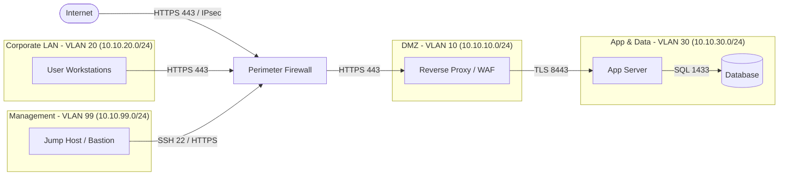
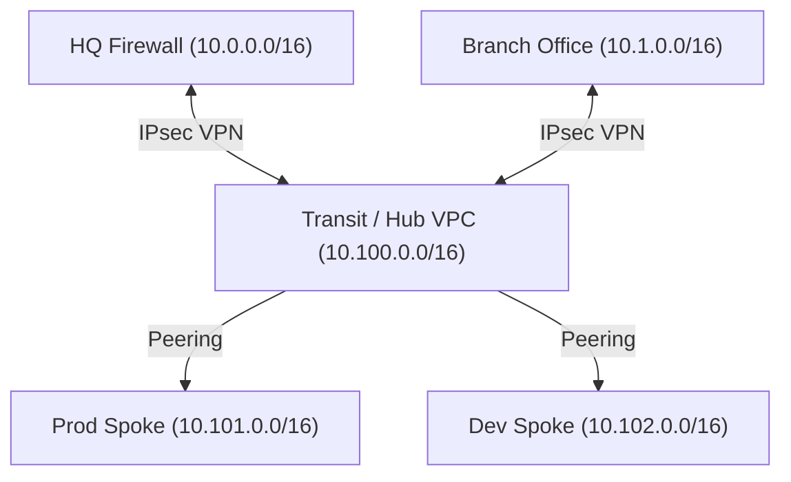

# Network Topology Mermaid Patterns

## Syntax Safety Rules
- Always use `flowchart LR` or `flowchart TD`.
- Always quote labels with special characters: `NODE["Web Server (10.10.1.10/24)"]`.
- Never use raw HTML tags inside Mermaid labels.
- Use `(["..."])` for external clouds/Internet, `["..."]` for routers/firewalls/servers, and `[("...")]` for databases.

## Pattern 1: Enterprise Perimeter + Segmented VLANs

## Pattern 2: Hub-and-Spoke Cloud / Site-to-Site VPN

